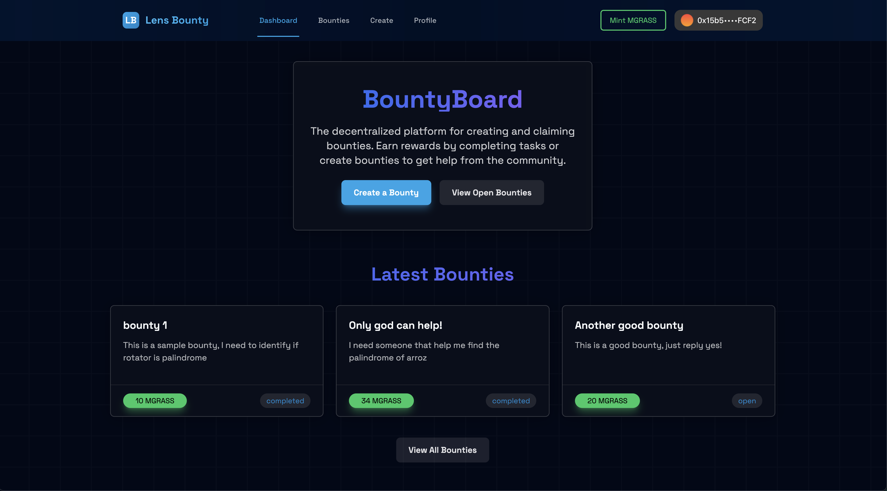
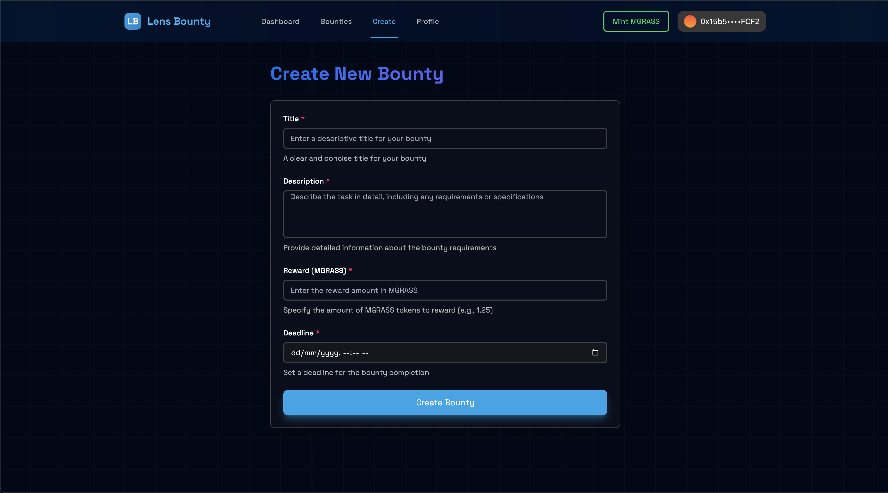
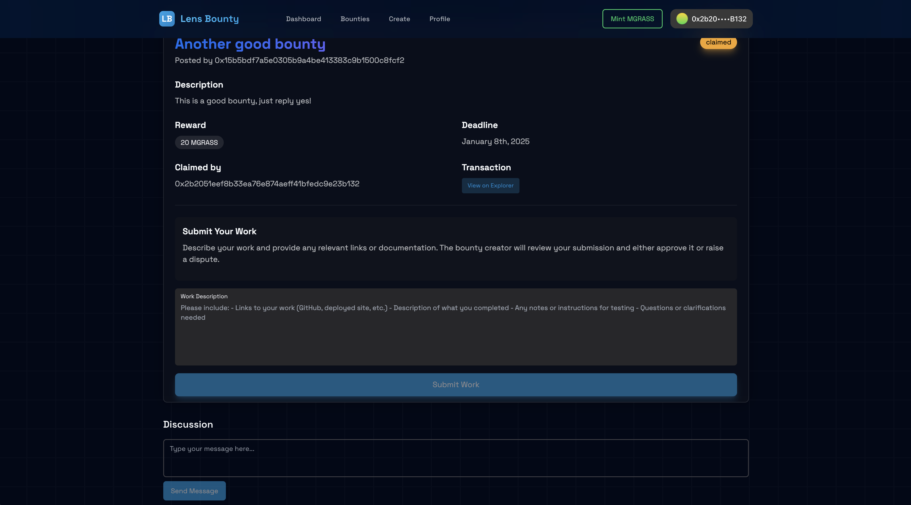
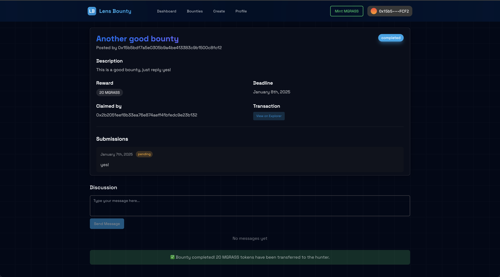

# Lens Holiday Hackathon Submission

## 🎯 Project Name:
**Lens Bounty Board**

---

## 👥 Team Members:
- hexMarc (Lens Handle: `@cool_boy`)
- MakeMake23 (Lens Handle: `@yisus_crais`)

---

## 📜 Project Description:
The **Lens Bounty Board** is a decentralized marketplace built on Lens Protocol and powered by Grass Tokens. It allows users to post tasks (bounties), complete them for rewards, and build an on-chain reputation. The platform integrates seamlessly with Lens profiles to ensure transparency, authenticity, and interoperability within the Lens ecosystem.

### Key Features:
1. **For Task Creators:**
   - Post bounties with custom Grass token rewards.
   - Set task requirements and deadlines.
   - Review submissions and release payments securely.

2. **For Task Hunters:**
   - Browse and claim bounties that match their skills.
   - Submit work via Lens posts or file uploads.
   - Earn Grass tokens and build a verifiable reputation.

3. **Reputation System:**
   - On-chain reputation and NFT badges for completed milestones.
   - Incentives for top contributors in the ecosystem.

4. **Lens Integration:**
   - Uses Lens Protocol for login and profile integration.
---

## 🔮 Potential Use Cases and Future Expansion

### 1. **Decentralized Gig Economy**
   - Expand the platform into a full-fledged decentralized gig marketplace.
   - Enable freelancers to find short-term contracts with transparent, on-chain payment systems.

### 2. **Community Incentives**
   - Allow DAOs and Web3 communities to post collaborative tasks.
   - Introduce DAO-managed bounties where members vote to approve tasks and submissions.

### 3. **Cross-App Lens Ecosystem Integration**
   - Integrate deeper with Lens-based apps like Orb or Hey to expand visibility and interaction.
   - Allow task submissions as videos or rich content shared across the Lens ecosystem.

### 4. **Public Goods**
   - Facilitate bounties for public goods projects, such as translations, open-source software contributions, or educational content creation.
   - Build a reputation system to recognize contributors to community-driven initiatives.

### 5. **AI-Driven Task Matching**
   - Use AI to match task hunters with relevant bounties based on their skills and Lens activity.
   - Suggest personalized bounties to increase task fulfillment rates.

### 6. **MGrass Token Utility**
   - Introduce staking mechanisms for MGrass tokens to unlock exclusive features.
   - Allow users to earn governance rights or vote on featured bounties by holding MGrass tokens.

### 7. **Gamification**
   - Add leaderboards for top contributors and badge collectors.
   - Implement achievements and seasonal competitions to encourage participation.

### 8. **Enterprise Adoption**
   - Position the platform as a decentralized alternative to traditional freelancing platforms like Upwork or Fiverr.
   - Offer APIs for companies to programmatically post tasks and manage submissions.

---

## 🔗 Source Code Link:
[GitHub Repository](https://github.com/hexMarc/bountyBoard)

---

## 🌐 Preview Link (Optional):
[Live Demo](https://lensbountyboard.xyz)

---

## 🎥 Demo Video/Slide Deck Link (Optional):
[Demo Video](https://youtu.be/example-demo-link)

---

## 📸 Screenshots (Optional):

---

## 🚀 How It Works:
1. **Task Creation:** Users post bounties with rewards and requirements.
2. **Task Claiming:** Workers browse and claim tasks using their Lens profile.
3. **Submission and Review:** Workers submit work; creators review and approve submissions.
4. **Payment and Reputation:** Payments are released in Grass tokens, and workers build their on-chain reputation.

---

## 🛠️ Built With:
- **Frontend:** React, Next.js, Tailwind CSS
- **Backend:** Golang with Gin framework
- **Blockchain:** Solidity smart contracts deployed on Grass (Lens Protocol)
- **Wallet Integration:** Family’s Connect Kit
- **Storage:** IPFS for decentralized storage

---

## 📜 Additional Notes:
- The project highlights the power of decentralized systems to foster collaboration and reward contributions transparently.
- It is designed to integrate seamlessly with the Lens ecosystem, leveraging its social graph and network effects.

---