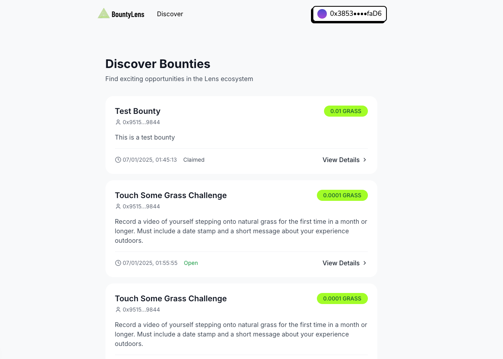
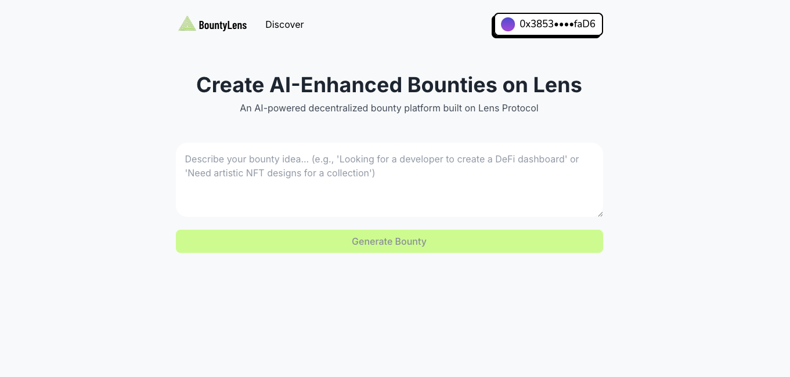
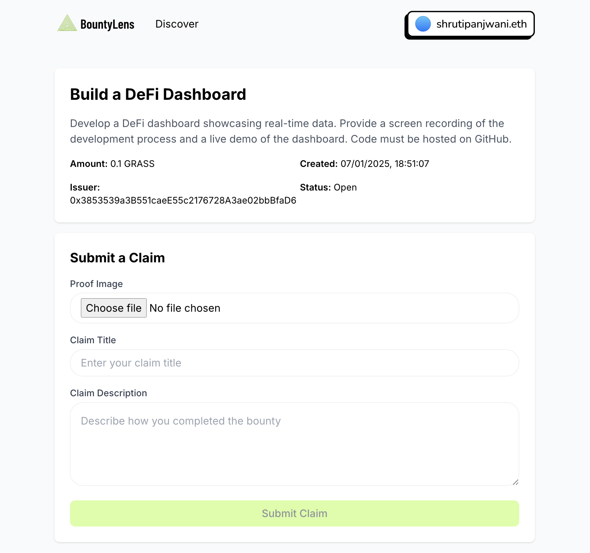
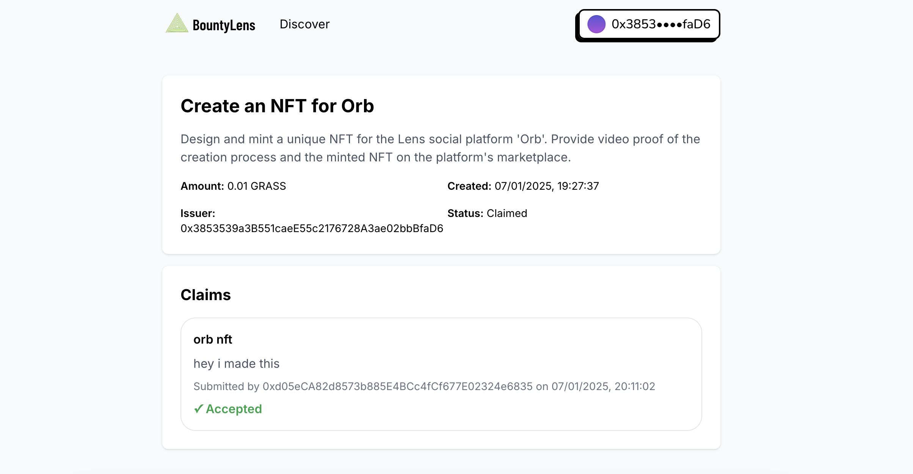

# BountyLens

## Team Members

[Shruti Panjwani] - [[@shrutipanjwani](https://github.com/shrutipanjwani)]
[Roshan Vadassery] - [[@roshanbvadassery](https://github.com/roshanbvadassery)]

## Project Description

BountyLens is an AI-powered decentralized bounty platform built on Lens Protocol where users can create, discover, and claim bounties with image proof verification.

## Key Features

- AI-enhanced bounty creation
- Image proof submission via IPFS/Pinata
- Direct integration with Lens Protocol
- Real-time bounty feed sorted by recency
- Smart contract-based verification

## Source Code Link

https://github.com/shrutipanjwani/bountylens

## Preview Link

https://bountylens.vercel.app/

## Tech Stack

- Next.js 13
- Lens Protocol
- Pinata Web3
- Ethers.js
- TailwindCSS

## Screenshots

### Main Feed

### Bounty Creation

### Claim Submission with IPFS

### Accepted Claims

